# SSX 3 × SSX Tricky courses

[](docs/ssx-tricky-trailer.mp4)

▶ **[Watch the trailer](docs/ssx-tricky-trailer.mp4)** (no sound)

**The SSX Tricky courses, playable in SSX 3.** Ride Garibaldi, Snowdream, Elysium Alps,
Mesablanca, Merqury City Meltdown, Tokyo Megaplex, Aloha Ice Jam, Alaska, Untracked,
Pipedream and the Trick Tutorial with SSX 3's riders, tricks, ubers and physics. Each course
keeps its original terrain, textures, lighting, sky, rails, shortcuts, moving props, crowds,
video screens and fireworks.

The game runs natively on your PC. It is not an emulator and not a disc patch. You build it
from source, using your own copies of both games.

> **Credit where it's due.** The hard part, porting SSX 3 to native Rust, is
> **[Anders Fischer-Nielsen's ssx3-decomp](https://github.com/andersfischernielsen/ssx3-decomp)**,
> with contributions from its community. This fork **only adds the SSX Tricky courses** and the
> fixes they needed. Go star the original.

> SSX 3 and SSX Tricky are © Electronic Arts; "SSX" is an EA trademark. This project is not
> affiliated with or endorsed by EA. **This repository contains no game data and no game
> code.** Everything game-related is generated on your machine from **your own discs**, is
> ignored by git, and must never be shared.

## The courses

All of them are under **Single Event → Peak Tricky**: 19 events in total.

| | Course | Modes |
| --- | --- | --- |
| 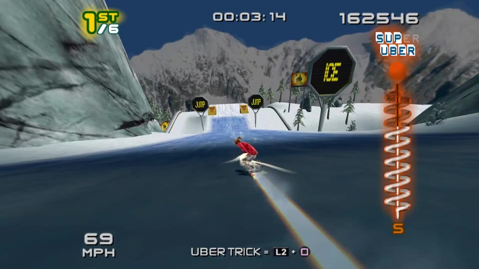 | **Garibaldi** | Race, Freestyle |
| 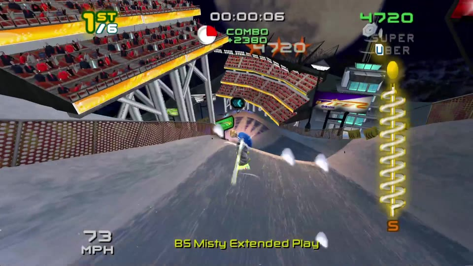 | **Snowdream** | Race, Freestyle |
| 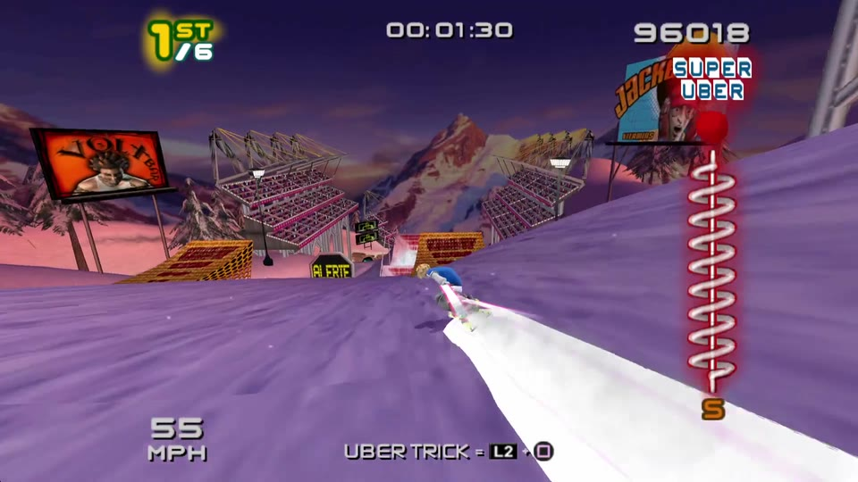 | **Elysium Alps** | Race, Freestyle |
| 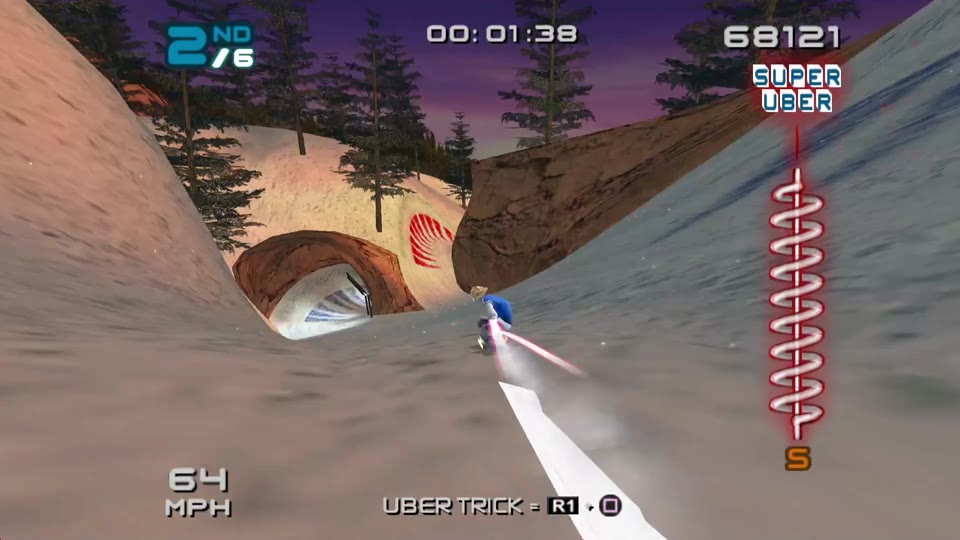 | **Mesablanca** | Race, Freestyle |
| 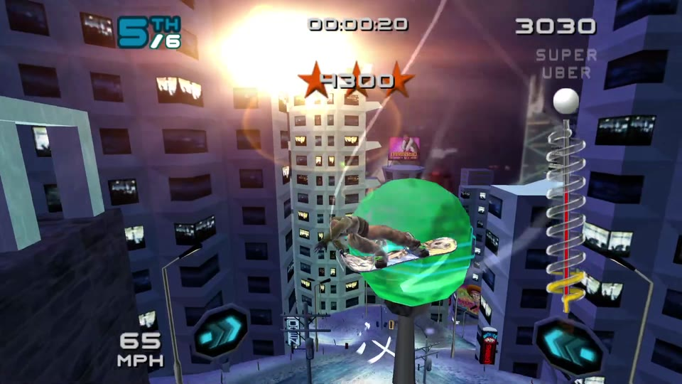 | **Merqury City Meltdown** | Race, Freestyle |
| | **Tokyo Megaplex** (the tube loop sends you around 3 laps) | Race, Freestyle |
| 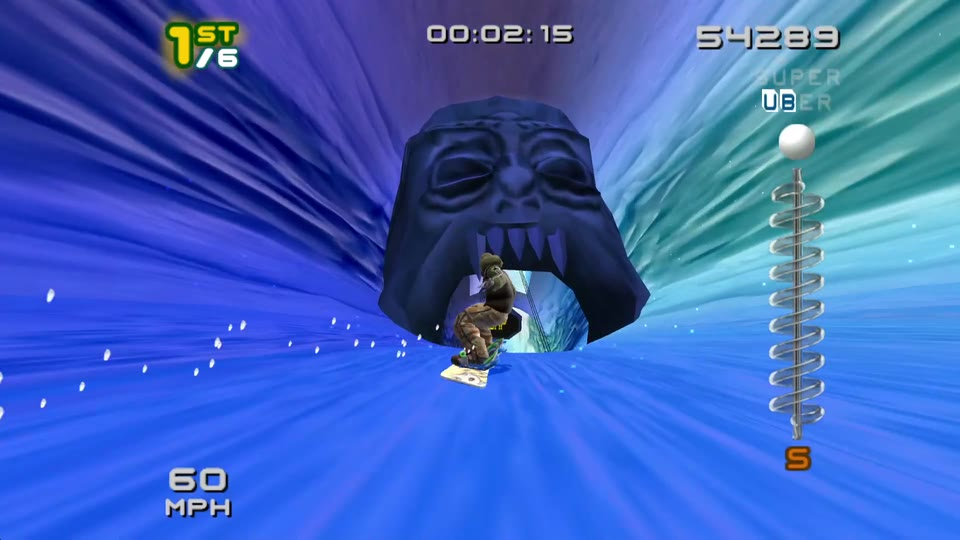 | **Aloha Ice Jam** | Race, Freestyle |
| 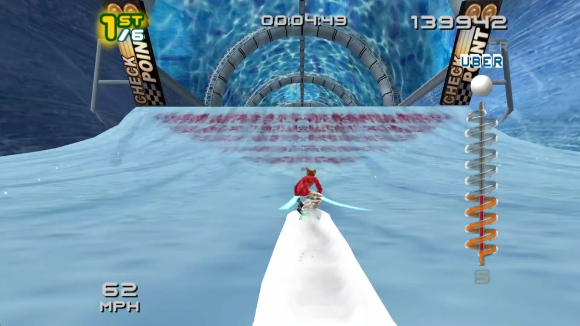 | **Alaska** | Race, Freestyle |
| 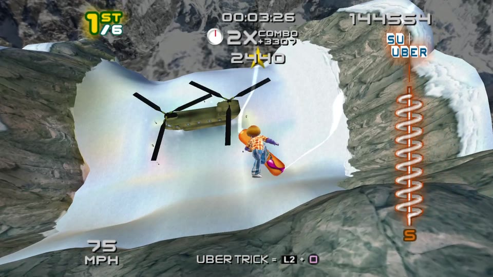 | **Untracked** | Race |
| 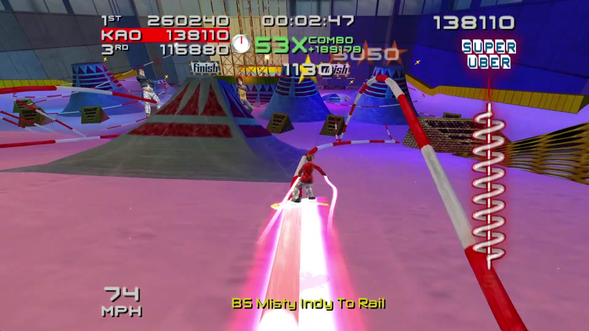 | **Pipedream** | Freestyle |
| | **Trick Tutorial** | Freestyle (untimed) |

- **Race**: you against five SSX 3 riders, who follow routes converted from Tricky's own
  racing lines. Countdown, knockdowns, checkpoints and results work as in SSX 3.
- **Freestyle**: a solo trick run with SSX 3's slopestyle scoring, using Tricky's Showoff
  timers. Checkpoints add time. The ×2, ×3 and ×5 multiplier gems are placed where Tricky had them.

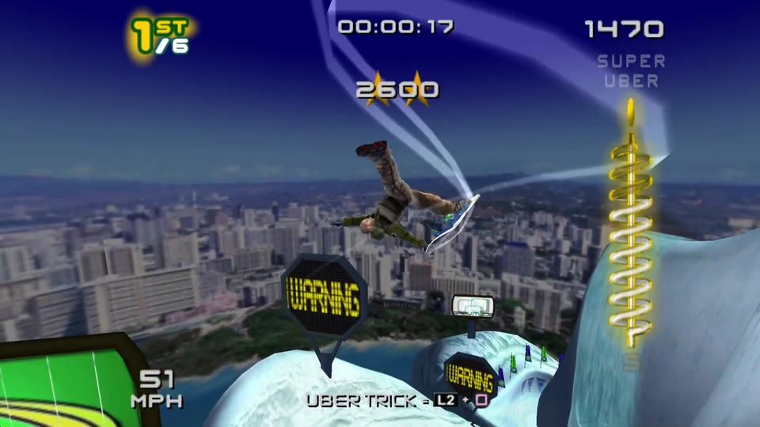

## What you need

- **Your own disc images**, both **USA** versions:
  - **SSX 3 (USA)**: `SLUS-20772`, about 3 GB. Setup checks it, so other regions won't work.
  - **SSX Tricky (USA)**: `SLUS-20326`.
- **Windows 10/11**, where the Tricky courses are developed and tested. SSX 3 itself also runs
  on **macOS** (Apple Silicon), but the Tricky courses haven't been tried there yet. Linux
  builds, but playing on it is untested.
- A GPU with **DirectX 12, Vulkan or Metal**.
- About **10 GB** of free disk space (the game build plus the converted courses).
- The build tools, all free:
  - **[Git](https://git-scm.com/downloads)**
  - **[Python 3](https://www.python.org/downloads/)** (on Windows, tick "Add python.exe to PATH")
  - **[Rust](https://rustup.rs)** (the default "stable" install)
  - **Windows only:** [Visual Studio Build Tools](https://visualstudio.microsoft.com/visual-cpp-build-tools/)
    with the **Desktop development with C++** workload. Rust needs it.

## Install

### Windows

Open **PowerShell** and run these one at a time:

```powershell
git clone --branch v0.1.2 https://github.com/npiriou/ssx3-decomp-more.git
cd ssx3-decomp-more
```

Copy your two disc images into that `ssx3-decomp-more` folder and name them exactly
**`SSX 3 (USA).iso`** and **`SSX Tricky (USA).iso`**. Then:

```powershell
python tools/setup.py
python tools/prepare_tricky_tracks.py
cargo run --profile game -p ssx3
```

1. `setup.py` reads your SSX 3 disc, checks it and generates the game's code.
2. `prepare_tricky_tracks.py` converts the 19 Tricky course variants from your Tricky disc.
   This takes a while the first time.
3. `cargo run` compiles and launches the game. **The first compile is long**, because there is
   a lot of generated code. Later launches are quick.

### macOS (and Linux)

Same steps in a terminal, with `python3` instead of `python`:

```sh
git clone --branch v0.1.2 https://github.com/npiriou/ssx3-decomp-more.git
cd ssx3-decomp-more
# copy your images here as "SSX 3 (USA).iso" and "SSX Tricky (USA).iso"
python3 tools/setup.py
python3 tools/prepare_tricky_tracks.py
cargo run --profile game -p ssx3
```

On Linux, first install `pkg-config`, `libasound2-dev` and `libudev-dev`.

**Disc images somewhere else?** Point to them instead of copying them. In PowerShell:
`$env:SSX3_ISO = "D:\isos\ssx3.iso"` and `$env:SSX_TRICKY_ISO = "D:\isos\tricky.iso"`.
On macOS/Linux, use `export SSX3_ISO=...` and `export SSX_TRICKY_ISO=...`.

### Playing again later

From the `ssx3-decomp-more` folder, just run:

```sh
cargo run --profile game -p ssx3
```

## How to play

Pick your rider, then go to **Single Event → Peak Tricky**. Peak Tricky sits right below
Peak 1. Choose **Race** or **Freestyle**, then a course. Your SSX 3 career, saves and original
events are untouched; the Tricky courses live alongside them.

A controller is picked up automatically. Buttons map by position: bottom ✕, right ○, left □,
top △.

| Keyboard | PS2 | | Keyboard | |
| --- | --- | --- | --- | --- |
| Arrows | D-pad | | **F10** | Settings (pauses the game) |
| I / J / K / L | Left stick: up / left / down / right | | **F11** | Fullscreen |
| X / S / Z / A | ✕ / ○ / □ / △ | | **F12** | Screenshot |
| Q / W, 1 / 2 | L1 / R1, L2 / R2 | | | |
| Enter / Right Shift | Start / Select | | | |

**F10** opens the settings: resolution (including widescreen and ultrawide), field of view,
game rate (60 to 240 Hz), anti-aliasing, draw distance and more. Settings are saved to
`saves/ssx3-settings.cfg`; your memory card is `saves/ssx3-mc0.ps2`. Every option is listed in
[`docs/options.md`](docs/options.md).

**Shortcut:** start straight into a course without going through the menus:

```powershell
$env:SSX3_EVENT = "ALOHA:race"     # macOS/Linux: SSX3_EVENT=ALOHA:race cargo run --profile game -p ssx3
cargo run --profile game -p ssx3
Remove-Item Env:SSX3_EVENT
```

Course codes: `GARI`, `SNOW`, `ELYSIUM`, `MESA`, `MERQUER`, `MEGAPLE`, `ALOHA`, `ALASKA`,
`UNTRACK`, `PIPE`, `TRICK`, each followed by `:race` or `:freestyle`.

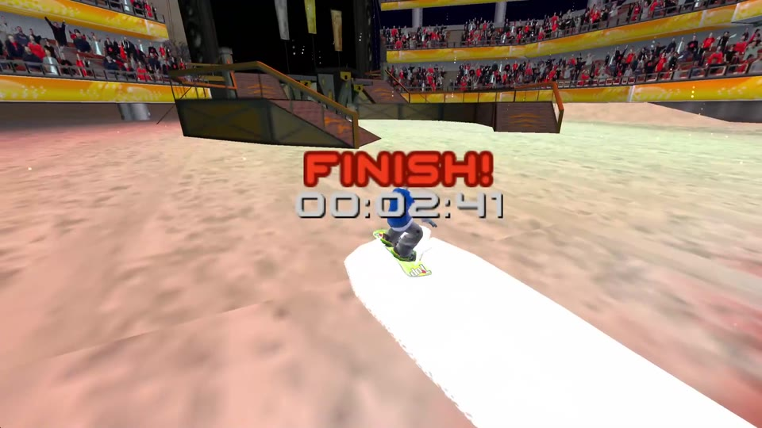

## Updating

```sh
git fetch --tags
git checkout v0.1.2        # or whichever release is newest
python tools/setup.py
python tools/prepare_tricky_tracks.py
cargo run --profile game -p ssx3
```

(`python3` on macOS/Linux.) The course converter only rebuilds what changed, so re-running it
is cheap. Run it after every update anyway, since releases sometimes fix how courses are
converted. The release notes say when that matters.

## Credits

- **[Anders Fischer-Nielsen](https://github.com/andersfischernielsen)** and the
  [ssx3-decomp](https://github.com/andersfischernielsen/ssx3-decomp) contributors, who made
  SSX 3 run natively. Everything here is built on their work; see that repository for the port
  itself, its architecture and how to contribute to it.
- **[DevvyDont/ssx3](https://github.com/DevvyDont/ssx3)**: the C++ decompilation used as a
  reading aid.
- **[GlitcherOG/SSX-Library](https://github.com/GlitcherOG/SSX-Library)**: the reference for
  SSX Tricky's file formats.
- **[swax/OpenSlope](https://github.com/swax/OpenSlope)**: research on Tricky's boost volumes.

For the technical details of how the courses are converted (terrain, collisions, rails, AI
routes, object scripts), see [`docs/modding/custom-tracks.md`](docs/modding/custom-tracks.md).

Licensed under the [MIT License](LICENSE). This covers the code in this repository, not any EA game material.
